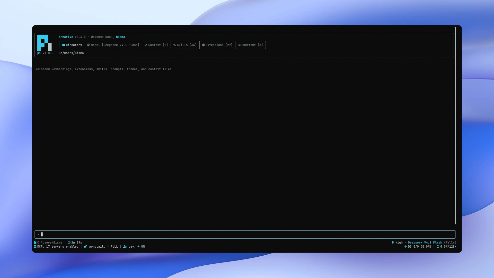

# Arnative

Refined aesthetics. Cohesive tools. Built for Pi.

[](https://pi.dev/packages/@bismawy/pi-arnative)
[](https://www.npmjs.com/package/@bismawy/pi-arnative)
[](https://github.com/bismawy/pi-arnative)



## Overview

`pi-arnative` replaces Pi's default terminal UI with warm themes, rounded tool boxes, a tabbed header, a status footer, and session tools.

- **Themes:** 14 contrast-checked OKLCH themes (`arnative` and 13 variants).
- **Header:** Tabbed box showing Directory, Model, Context, Skills, Extensions, and Shortcuts.
- **Tool boxes:** Grouped by default into one clickable chronological phase accordion per turn (`/arnative` → `Tool layout`), with the final reply below it. `Classic` restores the per-tool rounded boxes with status, spinner, duration, and clickable `[show]` or `[hide]` toggles.
- **Task list:** `todo` tool, `/todos` recap screen, and a boxed widget above the editor that hides 30s after all tasks finish.
- **Footer:** 3-row status grid (`Arnative (Full)`) or a single collapsible row (`Arnative (Minimal)`) with git branch, diff stats, active duration, token speed, and optional session cost.
- **Spinners and timestamps:** 18 animated spinner presets with an optional `[g]` gradient sweep, plus per-message timestamps and bubble backgrounds.
- **Usage and budget:** `/usage` tracks local token counts and spend across sessions, with optional Prometheus export to `~/.pi/agent/arnative/usage.prom` (set `PI_ARNATIVE_EXPORT=0` to disable). Budget settings in `/arnative` add UTC day and rolling 30-day spend caps with footer warnings at 80% and 100%, and can block the next turn when enforced.
- **Providers and model heal:** `/providers` probes endpoints and saves OpenAI-, Anthropic-, Gemini-, or Ollama-compatible channels to `models.json` and `auth.json`. `/model-heal` fills missing compat flags, `/models` token limits, and accepted reasoning effort levels.
- **Context and rendering:** `Render cache` (`On` by default) caches settled transcript components in `chatContainer`. `Auto-compact` (`Off` by default) triggers compaction via Smart tiers or a fixed token budget, with silent in-memory byte trimming for byte-capped proxies.

## Install

```bash
pi install npm:@bismawy/pi-arnative
```

Requires a [Nerd Font](https://www.nerdfonts.com/font-downloads). On a fresh install, `arnative` is applied automatically if no theme is set. You can switch themes anytime from `/arnative` or `/settings`.

For local development:

```bash
npm run dev                  # run pi against this checkout without installing
npm run overlay              # copy extensions/, lib/, and themes/ into the installed npm package
```

Run `npm run overlay` and then `/reload` in Pi to test local changes without reinstalling or restarting. Removed modules are pruned from the installed copy, and `pi update --extensions` restores the published package when a newer version is out. Use `npm run overlay -- --dry-run` to preview changes, or set `PI_CODING_AGENT_DIR` to target another agent directory.

## Commands and shortcuts

| Command | Purpose |
| --- | --- |
| `/arnative` | Open settings (Themes, Headers, Footers, Animations, Render cache, Auto-compact, Model heal, Payload limit, Providers, Usage, Budget) |
| `/usage` | Open the token and cost dashboard |
| `/todos` | Open the full task list recap |
| `/providers` | Manage custom providers |
| `/model-heal` | Run `models.json` heal passes now |

In `/usage`, press `R` to reset model and provider statistics after confirmation. Session files are left untouched and stay available in `/resume`. New messages are counted from the reset baseline in `~/.pi/agent/arnative/usage-baseline.json`, and `U` undoes the latest reset while the dashboard is open.

| Key (Linux / Win) | Action |
| --- | --- |
| `ctrl+alt+a` · `alt+a` | Open settings menu (`/arnative`) |
| `ctrl+alt+t` · `alt+t` | Cycle header tabs |
| `ctrl+alt+r` · `alt+r` | Quick reload (`/reload`) |
| `ctrl+alt+n` · `alt+n` | New session (`/new`) |
| `ctrl+alt+m` · `alt+m` | Toggle Minimal footer |
| `ctrl+alt+o` · `alt+o` | Expand or collapse task list |
| `ctrl+alt+j` · `alt+j` | Scroll task list down |
| `ctrl+alt+k` · `alt+k` | Scroll task list up |
| Click `[show]` / `[hide]` · `ctrl+o` | Toggle tool output box |
| `←` / `Esc` | Go back or close active screen |

<details>
<summary>Keybindings and platform notes</summary>

Bind `app.session.new` in `~/.pi/agent/keybindings.json`:
```json
{
  "app.session.new": ["ctrl+alt+n", "alt+n"]
}
```

- **Windows / WSL:** Windows Terminal maps `Ctrl+Alt` to AltGr. Use `alt+...` or disable `altGrAliasing`.
- **macOS:** Use `ctrl+option+...`.
- **tmux / Herdr:** Set `PI_TUI_ESC_TIMEOUT=100` if `Esc` feels delayed.

</details>

<details>
<summary>Configuration and presets</summary>

Settings from `/arnative` are saved in `~/.pi/agent/arnative/config.json`:

- **Headers and footers:** `Arnative (Full)` (default), `Arnative (Minimal)` (footer only; click the head text or press `ctrl+alt+m` to toggle), or `Pi (system)`.
- **Footer cost:** Off by default. Press `[c]` in the Footers picker to show session cost (`$0.42`, or `~$0.42` when estimated) in the metrics row.
- **Chatbox:** `Arnative` (default rounded box with 12 prompt icons cycled via `[i]`, colored `primary` while typing and `dim` after 3s idle) or `Pi (system)`. Press `[D]` to position the working status dialog (`Left`, `Center`, `Right`, `Inside`, `Outside`).
- **Animations:** 18 presets (`Arnative` default, `Pi (system)`, and variants). Press `[g]` in the picker to toggle the gradient sweep.
- **Tool layout:** `Grouped` by default. Each turn collapses into one accordion of chronological phases (`Explored`, `Updated`, `Ran`, named from what the tools did) with auto-expanded running and failed phases and `↑`/`↓ N more` scrolling on tall turns. `Classic` renders every tool in its own box.
- **Render cache:** `On` by default. Reuses rendered lines for settled transcript items in `chatContainer`. Streaming items, active animations, and custom renderers bypass the cache.
- **Auto-compact:** `Off` by default (Pi core compaction handles context). `Smart` adapts to `Render cache` and `contextWindow` (triggers at 90% on `>= 192k` windows when `Render cache` is `On`, or conservative tiers when `Off`). Fixed budgets (`100k` to `400k`) trigger at an absolute token count, subject to Pi core `reserveTokens` and provider limits.
- **Payload limit:** Configured in `/arnative` or `PI_ARNATIVE_BYTE_WALL_MB` (`Off`, `1 MB`, `4 MB`, `8 MB`, `16 MB`, `32 MB`, or `Custom` from 1 to 1024 MB). For `remote/*`, `remote-magpie/*`, and models that return HTTP 413, payloads near the ceiling are trimmed in memory before sending without changing session history.
- **Model heal:** `Full` (default: offline compat flags, `GET /models` limits, and reasoning effort probes cached locally), `Flags` (offline only), or `Off`. Hand-edited fields are never overwritten.
- **Task list:** Stored per session in `~/.pi/agent/arnative/todos/<session-id>.json` (uninstall `@juicesharp/rpiv-todo` first to avoid a tool name conflict). Auto-hides 30s after completion (`PI_ARNATIVE_TODO_HIDE_MS` overrides the delay; `0` hides immediately).

</details>

<details>
<summary>Architecture and development</summary>

| File | Role |
| --- | --- |
| `extensions/index.ts` | Single Pi extension entry point composing all features |
| `lib/runtime.ts` | Centralized reload-safe `RuntimeState` and single-listener lifecycle hub |
| `lib/features/arnative.ts` | `/arnative` settings menu and live preview pickers |
| `lib/features/headers.ts` | Tabbed header and resource box |
| `lib/features/footer.ts` | 3-row status grid, Minimal footer, and boxed editor |
| `lib/features/tools.ts` | Rounded tool boxes, spinners, duration, and `[show]` / `[hide]` toggles |
| `lib/features/todos.ts` | `todo` tool, boxed widget above editor, and `/todos` screen |
| `lib/features/animations.ts` | Spinner preset picker and live preview |
| `lib/features/auto-compact.ts` | Smart and fixed-budget context compaction plus silent byte-wall shedding |
| `lib/features/render-cache.ts` | Per-child and container transcript render cache for `chatContainer` |
| `lib/features/budget.ts` | UTC day and rolling 30-day spend caps and footer warnings |
| `lib/features/usage-export.ts` | Prometheus textfile metric export (`usage.prom`) |
| `lib/features/model-heal.ts` | Automatic `models.json` heal triggers and `/model-heal` |
| `lib/features/timestamps.ts` | Message timestamps and bubble backgrounds |
| `lib/features/ui-render-tweaks.ts` | Contrast tweaks, selection styling, and UI polish |
| `lib/features/usage.ts` | Token and cost dashboard (`/usage`) |
| `lib/todos.ts` | Task state, window layout, box rows, and session store |
| `lib/spinner.ts` | Spinner preset catalog, frames, and gradient painters |
| `lib/active-clock.ts` | Active session clock, duration formatting, and input activity filter |
| `lib/git-status.ts` | Git branch/status/diff-stat collector and path shortener |
| `lib/chatbox.ts` | Editor frame, prompt glyph styling, scroll borders, and dialog placement |
| `lib/edit-diff.ts` | Unified and side-by-side word-level edit diff renderer |
| `lib/provider-store.ts` | Custom provider probe, metadata merge, and `models.json` / `auth.json` store |
| `lib/provider.ts` | Interactive `/providers` wizard UI |
| `lib/usage-pricing.ts` | `models.json` price table loader, cost estimation, and UTC range math |
| `lib/model-heal.ts` | Compat flags, `/models` limit sync, and reasoning effort probe |
| `lib/list-picker.ts` | Shared live-preview and multi-select picker component |

**Themes (`themes/gen-themes.mjs` + `lib/color.ts`):** `arnative` · `arnative-blossom` · `arnative-crimson` · `arnative-cyberpunk` · `arnative-dracula` · `arnative-earthy` · `arnative-garden` · `arnative-gruvbox` · `arnative-lemonade` · `arnative-magical` · `arnative-matrix` · `arnative-neutral` · `arnative-nord` · `arnative-zinc`

```bash
npm test                              # Run self-checks and unit tests
npm run themes                        # Regenerate theme JSON files
npm run preview                       # Live preview in Pi and stamp .git/arnative-preview
git config core.hooksPath .githooks   # Enable pre-push preview verification hook
```

</details>

## License

Distributed under the **MIT** license.

## Author

[Bisma](https://github.com/bismawy)
